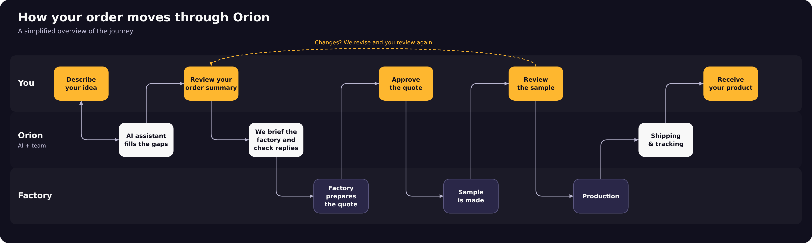
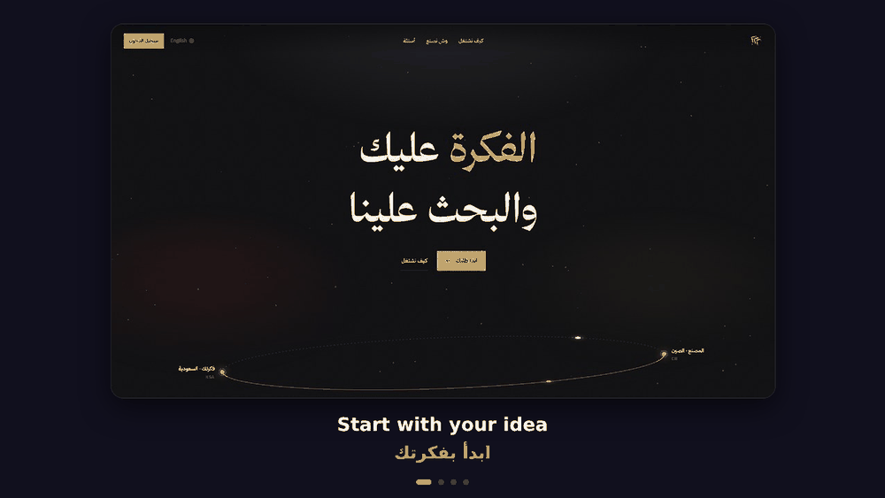
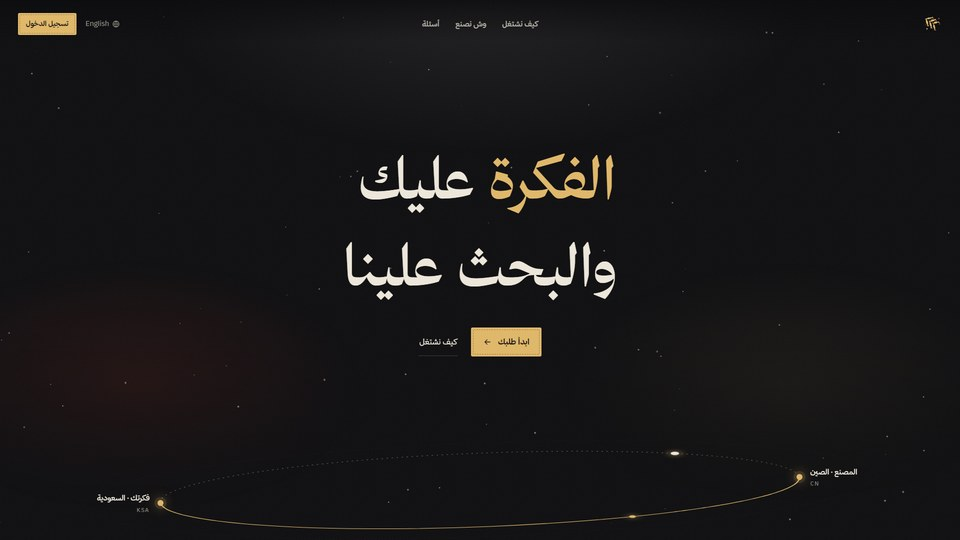
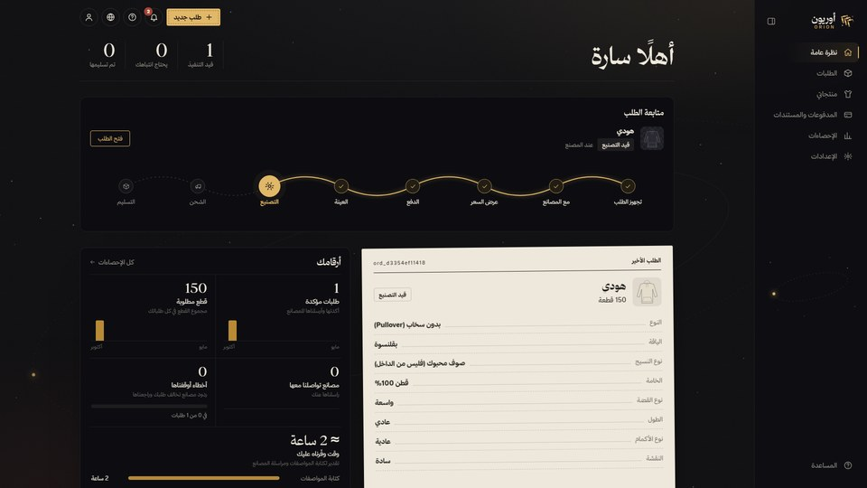
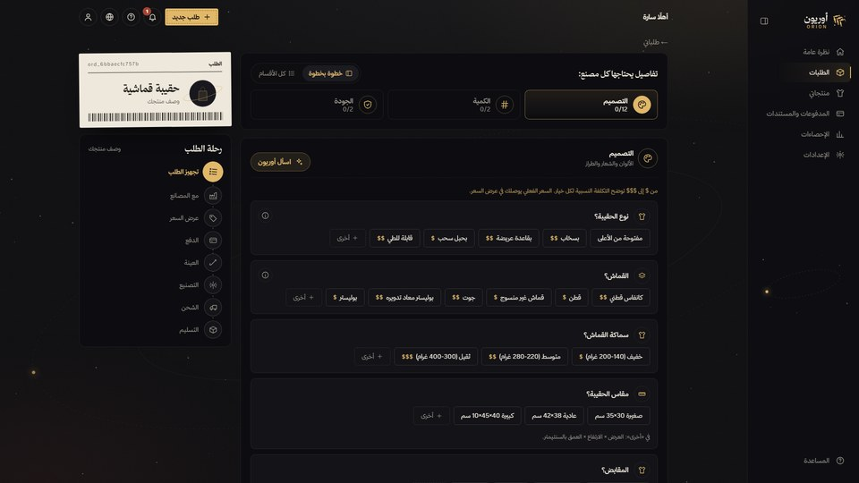
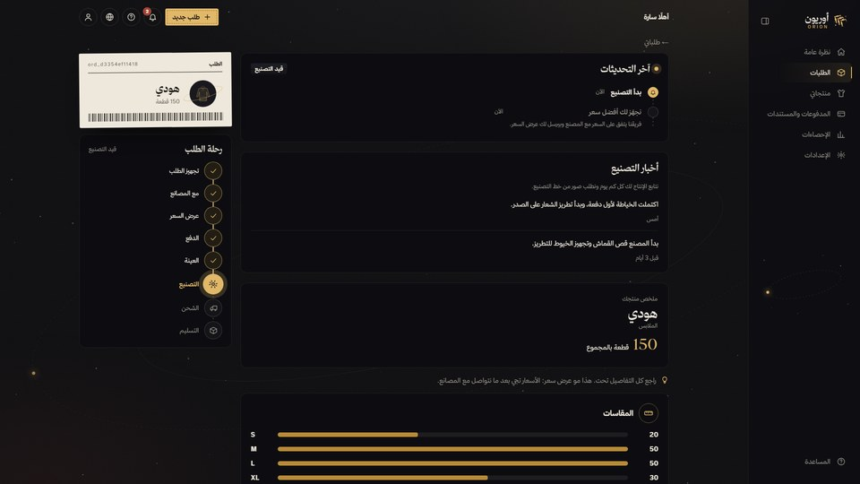
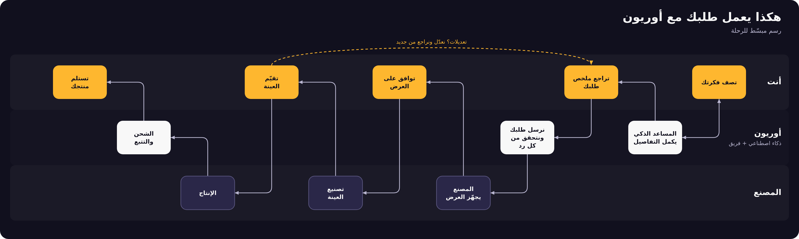

# Orion · أوريون

**The idea is yours. The rest is ours.**
**الفكرة عليك والباقي علينا**

An AI-guided platform that takes a business owner from a product idea to a finished product made by the right factory.

[Try the platform](https://orionagentic.online) · [Instagram](https://instagram.com/orion.ksa) · [TikTok](https://www.tiktok.com/@orion.saudi)

---

## What is Orion?

Starting a product business usually means finding factories, writing exact specifications, comparing offers, arranging samples and following production, all without a network or experience. Orion is that network.

You describe what you want in plain language. Orion turns it into a clear product file, talks to the factories for you, and keeps you updated until the product is on its way.

## How an order moves

1. **Describe your idea.** Chat in your own words, or send a photo or a link. No forms and no technical terms.
2. **Review your summary.** You see your whole product, in one place, before anything is sent to a factory.
3. **We work with the factory.** Your product file is shared with the factory, and every reply is checked against what you ordered.
4. **Approve, sample, receive.** You approve the quote, review the sample, and follow production and shipping step by step.

Saved products can be reordered in one click.

## See it in action

| | |
|---|---|
|  |  |
|  |  |

*Screens from the working prototype.*

## Who it is for

Online store owners, startups, and first-time entrepreneurs in Saudi Arabia and the Gulf who have an idea but not a factory network.

## Starting fields

Fashion and apparel · E-commerce packaging · Tech and lifestyle accessories. More fields are coming.

## Status

Orion is a working prototype and is being built in the open as a project, but **the platform's source code is private**. This repository is a public showcase only.

## Contact

[orionagentic.online](https://orionagentic.online) · Instagram [@orion.ksa](https://instagram.com/orion.ksa) · TikTok [@orion.saudi](https://www.tiktok.com/@orion.saudi)

---

## ما هو أوريون؟

لو بدأت مشروع منتج، فغالبًا ستحتاج مصانع، ومواصفات دقيقة، ومقارنة عروض، وعينات، ومتابعة للإنتاج، وكل ذلك بدون شبكة علاقات أو خبرة. أوريون هو هذه الشبكة.

تصف منتجك بكلامك العادي، فيحوّله أوريون إلى ملف منتج واضح، ويتواصل مع المصانع نيابة عنك، ويبقيك على اطلاع حتى يصل منتجك.

## كيف يسير طلبك

1. **صف فكرتك.** تكلّم بلغتك، أو أرسل صورة أو رابطًا. بدون نماذج ولا مصطلحات معقدة.
2. **راجع ملخصك.** ترى منتجك كاملًا في مكان واحد قبل أن يُرسل لأي مصنع.
3. **نتواصل مع المصنع.** يُشارك ملف منتجك مع المصنع، ويُقارَن كل رد بما طلبته.
4. **وافق، جرّب العينة، واستلم.** توافق على العرض، وتراجع العينة، وتتابع الإنتاج والشحن خطوة بخطوة.

والمنتجات المحفوظة تعيد طلبها بضغطة.

## شاهد المنصة

*الشاشات من النموذج الأولي العامل.*

## لمن؟

أصحاب المتاجر الإلكترونية، والشركات الناشئة، ورواد الأعمال الجدد في السعودية والخليج، ممن عندهم فكرة وليس عندهم شبكة مصانع.

## المجالات الأولى

الأزياء والملابس · تغليف المتاجر الإلكترونية · إكسسوارات التقنية ونمط الحياة. ومجالات أخرى قريبًا.

## الحالة

أوريون نموذج أولي يعمل، **لكن الكود المصدري للمنصة خاص**. هذا المستودع للعرض فقط.

---

© Orion. All rights reserved. Nothing in this repository is licensed for copying, reuse or redistribution.
